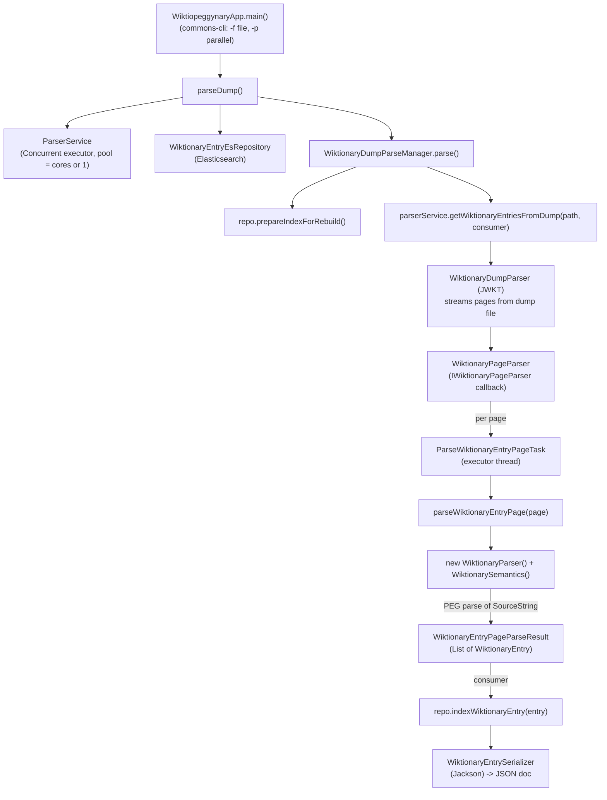

# `wiktio-peggy-nary` — Architecture Analysis

**What it is:** A command-line tool that parses a German Wiktionary dump (one page per dictionary entry) into structured `WiktionaryEntry` objects and indexes them into Elasticsearch. The core technique is a **Parsing Expression Grammar (PEG)** parser, generated by the [Mouse](http://www.romanredz.se/freesoft.htm) tool from a declarative grammar.

---

## Build & Language

- Pure **Java 25** project: Gradle `java` plugin, standard source sets (`src/main/java`, `src/test/java`). Groovy/Spock were fully removed (2026-11): former Groovy model/persistence classes became Java (records for immutable value types), and the Spock specs were ported to JUnit 5.
- The same de-Groovification happened in the sibling library `wiktionary-dump-browser`, so no Groovy runtime is on the classpath anywhere.

---

## Data Flow



---

## Source Tree

```text
wiktio-peggy-nary/
├── build.gradle                  # Gradle Groovy DSL, java plugin
├── settings.gradle
├── gradlew / gradlew.bat
├── gradle/wrapper/
├── README.md
├── ARCHITECTURE.md
└── src/
    ├── main/
    │   ├── resources/
    │   │   ├── entry_grammar.txt          # PEG grammar (Mouse 1.9)
    │   │   ├── ignored_entries.txt        # titles skipped during parsing
    │   │   └── logback.xml
    │   ├── java/wiktiopeggynary/
    │   │   ├── WiktiopeggynaryApp.java    # CLI entry point
    │   │   ├── WiktionaryDumpParseManager.java  # orchestrator
    │   │   ├── parser/
    │   │   │   ├── ParserService.java
    │   │   │   ├── ParseException.java
    │   │   │   ├── ParserTaskExecutorFactory.java
    │   │   │   ├── ConcurrentParserTaskExecutorFactory.java
    │   │   │   ├── WiktionaryEntryPageParseResult.java
    │   │   │   ├── WiktionaryParser.java          # GENERATED by Mouse
    │   │   │   ├── WiktionarySemantics.java       # semantic actions (model builder)
    │   │   │   ├── mouse/                          # vendored Mouse PEG runtime
    │   │   │   │   ├── CurrentRule.java
    │   │   │   │   ├── Deferred.java
    │   │   │   │   ├── ParserBase.java
    │   │   │   │   ├── ParserMemo.java
    │   │   │   │   ├── ParserTest.java
    │   │   │   │   ├── Phrase.java
    │   │   │   │   ├── SemanticsBase.java
    │   │   │   │   ├── Source.java
    │   │   │   │   ├── SourceFile.java
    │   │   │   │   └── SourceString.java
    │   │   │   └── dumpparser/
    │   │   │       ├── WiktionaryPageParser.java    # JWKT IWiktionaryPageParser impl
    │   │   │       └── WiktionaryPageDocument.java
    │   ├── model/
    │   │   ├── Kasus.java
    │   │   ├── Numerus.java
    │   │   ├── ReferenceWiktionaryEntry.java
    │   │   ├── WiktionaryEntry.java             # base model
    │   │   ├── WiktionaryEntrySerializer.java   # Jackson
    │   │   ├── markup/                           # rich-text components (Visitor)
    │   │   │   ├── CursiveBlock.java
    │   │   │   ├── CompoundRichTextComponent.java
    │   │   │   ├── Constant.java
    │   │   │   ├── InternalLink.java
    │   │   │   ├── ItemNumber.java                   # record
    │   │   │   ├── KTemplate.java                    # record + nested Part record
    │   │   │   ├── LanguageVariant.java              # record
    │   │   │   ├── NamedTemplateParameter.java
    │   │   │   ├── NumberedTemplateParameter.java
    │   │   │   ├── PlainText.java
    │   │   │   ├── PositionalTemplateParameter.java
    │   │   │   ├── RichText.java
    │   │   │   ├── RichTextComponent.java
    │   │   │   ├── TemplateParameter.java
    │   │   │   └── WikipediaLink.java                # record
    │   │   ├── meaning/
    │   │   │   ├── KontextShortcutMapper.java
    │   │   │   └── Meaning.java
    │   │   ├── substantiv/
    │   │   │   ├── Flexion.java
    │   │   │   ├── FlexionForm.java
    │   │   │   ├── Gender.java
    │   │   │   ├── MultiGender.java
    │   │   │   └── Substantiv.java
    │   │   ├── translation/
    │   │   │   ├── Translation.java
    │   │   │   └── TranslationMeaning.java
    │   │   └── visitor/
    │   │       ├── DefaultRichTextComponentVisitor.java
    │   │       ├── DescendingRichTextComponentVisitor.java
    │   │       ├── RichTextComponentVisitor.java
    │   │       └── TemplateParameterVisitor.java
    │   └── persistence/
    │       └── WiktionaryEntryEsRepository.java  # Elasticsearch
    └── test/
        ├── java/wiktiopeggynary/
        │   ├── model/
        │   │   ├── WiktionaryEntrySerializerTest.java
        │   │   ├── markup/
        │   │   │   └── RichTextComponentTest.java
        │   │   └── translation/
        │   │       └── TranslationMeaningTest.java
        │   └── parser/
        │       ├── GeneralParserTest.java
        │       ├── MeaningsParserTest.java
        │       ├── ParserSpecBase.java
        │       ├── SubstantivParserTest.java
        │       ├── TranslationsParserTest.java
        │       └── util/
        │           ├── ResourceParserRunner.java
        │           └── ResourceUtils.java
        └── resources/
            └── articles-de/              # ~60 German article fixtures
```

---

## Layer-by-Layer

### 1. Entry / Orchestration (`wiktiopeggynary/`)

- `WiktiopeggynaryApp` — `main()` parses CLI (`-f` dump path, `-p` parallel), builds a `ParserService` + `WiktionaryEntryEsRepository`, hands them to `WiktionaryDumpParseManager`, and calls `parse()`.
- `WiktionaryDumpParseManager` — thin orchestrator: `prepareIndexForRebuild()` → stream-and-index → `indexRebuildDone()`.

### 2. Parsing Pipeline (`parser/`)

- `ParserService` — the heart of the streaming logic:
  - Wraps the JWKT `WiktionaryDumpParser` with a `WiktionaryPageParser` (implements JWKT's `IWiktionaryPageParser` callback interface) that emits one `WiktionaryPageDocument` per page.
  - Filters out ignored entries (loaded from `ignored_entries.txt` resource) and null-namespace pages.
  - Submits each page to an `ExecutorService` as a `ParseWiktionaryEntryPageTask`; per-page failures are logged to a dedicated `erroneous_wiktionary_entries` logger and never abort the run.
  - `parseWiktionaryEntryPage(String)` is the atomic unit (also the unit under test): builds a `WiktionaryParser` + `WiktionarySemantics`, runs `parser.parse(new SourceString(page))`, returns `Optional<WiktionaryEntryPageParseResult>`.
- `ParserTaskExecutorFactory` + `ConcurrentParserTaskExecutorFactory` — **Strategy pattern** seam for concurrency. Fixed `ThreadPoolExecutor` (pool size = `availableProcessors()` with `-p`, 1 without), zero-capacity `SynchronousQueue`, `CallerRunsPolicy` — pages are never queued, so buffering stays bounded in both modes.

### 3. PEG Parser Core (`parser/` + `parser/mouse/`)

- `entry_grammar.txt` (175 lines) — the **declarative PEG grammar** (Mouse 1.9). Top rule `Dokument`; handles German entries: language header (`DeSpracheKopf`), word-class (`SubstantivKopf`), flexion tables, `Bedeutungen` (meanings), `Übersetzungen` (translation tables), and general Wiki markup (links `[[…]]`, templates `{{…}}`, cursive, item numbers, refs/comments).
- `WiktionaryParser.java` — **code-generated** by Mouse from the grammar; extends `ParserBase`. Not hand-edited.
- `WiktionarySemantics.java` — the **semantic actions** (the `{…}` blocks in the grammar); extends `SemanticsBase`. This is where the model is actually built (`saveEintrag`, `createSubstantiv`, `substantivGender`, `addNomSg`, `addTranslationsForLanguage`, etc.).
- `mouse/` — the **vendored Mouse runtime** (`ParserBase`, `Source`, `Phrase`, `SemanticsBase`, `ParserMemo`, `SourceString`, …), Apache-2.0, copied in from the Mouse generator.

### 4. Data Model (`model/`)

- `WiktionaryEntry` (base): `lemma`, `List<Meaning>`, `Map<language, List<TranslationMeaning>>`.
- `Substantiv extends WiktionaryEntry`: `MultiGender`, attributes, `Map<Numerus, List<FlexionForm>>` (Singular/Plural flexion forms).
- `Meaning`: `List<ItemNumber>`, `RichText text`, nested `subMeanings`.
- `markup/` — a **tree of rich-text components** (`RichText`, `PlainText`, `InternalLink`, `TemplateParameter` + named/numbered/positional variants, `CursiveBlock`, `KTemplate`, `LanguageVariant`, `WikipediaLink`, `ItemNumber` …) built on a **Visitor pattern** (`RichTextComponentVisitor` + `Default`/`Descending` visitors) with `mergeWith` semantics. The value types that were Groovy (`ItemNumber`, `KTemplate` + `Part`, `LanguageVariant`, `WikipediaLink`) are now **Java records** — free `equals`/`hashCode`/`toString`, JSON shape unchanged. Annotated `@JsonTypeInfo(Id.MINIMAL_CLASS)` so Jackson can round-trip the polymorphic tree (record class names are identical to the old Groovy ones, so stored ES documents stay compatible).
- `substantiv/`, `translation/`, `meaning/` — supporting enums/value objects (`Gender`, `MultiGender`, `Numerus`, `Kasus`, `Flexion`, `FlexionForm`, `Translation`, `TranslationMeaning`).

### 5. Persistence (`persistence/`)

- `WiktionaryEntryEsRepository extends ElasticsearchIndexingRepository` (base class from the sibling project). Index `dewiktionary_entries`, type `entry`. Sets a mapping (`lemma` as `text` + `keyword` sub-field) on rebuild, indexes each entry under a random UUID.
- `WiktionaryEntrySerializer` — Jackson `ObjectMapper` wrapper; `FAIL_ON_UNKNOWN_PROPERTIES` disabled. Jackson's checked exceptions are wrapped in `UncheckedIOException` (the old Groovy code threw them unchecked; API stays throws-free).

---

## Key Design Decisions

1. **Declarative parsing** (the README's stated goal): parsing logic lives in `entry_grammar.txt`, semantic actions in `WiktionarySemantics`, and the parser is generated. This keeps the parser adaptable to changing Wiktionary templates without hand-written regex.
2. **Vendored PEG runtime** — the Mouse library is copied into `parser/mouse/` rather than pulled as a dependency.
3. **Strategy pattern** for executor creation; pool size (cores vs. 1) selected at startup.
4. **Visitor + merge** on the rich-text model to normalize/flatten markup before serialization.
5. **Resilient bulk processing** — per-page isolation, dedicated error logger, progress logging every 5000 pages.

---

## Dependencies & the Sibling Project

- `de.tudarmstadt.ukp.jwktl:jwktl:1.0.1` — JWKT toolkit; provides `WiktionaryDumpParser` + the `IWiktionaryPageParser`/`IDumpInfo` callback interfaces that `WiktionaryPageParser` implements.
- **`pl.kwitukiewicz:wiktionary-dump-browser:1.0-SNAPSHOT`** — the sibling project in this workspace (also pure Java since 2026-11). Provides the Elasticsearch base classes (`ElasticsearchIndexingRepository`, `ElasticsearchRepository`, `WiktionaryDumpEsRepository`). `WiktionaryEntryEsRepository` extends `ElasticsearchIndexingRepository`. The Gradle `updateTestData` task uses the sibling's `WiktionaryDumpEsRepository` to pull real articles into test fixtures.
- Jackson (JSON), Elasticsearch REST high-level client 5.6, commons-lang3, commons-cli, slf4j + logback.

---

## Testing

- JUnit 5 tests under `src/test/java`, extending `ParserSpecBase` (which builds a `ParserService` with a single-thread executor and parses fixtures from `src/test/resources/articles-de/*.txt` — ~60 real German articles). Tests cover `SubstantivParserTest`, `MeaningsParserTest`, `TranslationsParserTest`, `GeneralParserTest`, plus `WiktionaryEntrySerializerTest`, `RichTextComponentTest`, `TranslationMeaningTest`. The old Spock `where:` data tables are now JUnit `@ParameterizedTest`s.

---

## How to Run

### Prerequisites

1. **Elasticsearch** reachable at `localhost:9200` (HTTP), user `elastic` / password `changeme` — these are hardcoded in the sibling's `ElasticsearchRepository`. The tool **deletes and recreates** the `dewiktionary_entries` index on every run.
2. **Sibling project** `wiktionary-dump-browser` installed to local Maven — `build.gradle` resolves `pl.kwitukiewicz:wiktionary-dump-browser:1.0-SNAPSHOT` from `mavenLocal()`. Build it first:
   ```bash
   cd ../wiktionary-dump-browser && ./gradlew publishToMavenLocal
   ```
3. **A German Wiktionary dump** — a MediaWiki `*-pages-articles-multistream.xml` file (the author's run config points at `dewiktionary-20170820-pages-articles-multistream.xml`).

### Build

```bash
./gradlew build      # or: ./gradlew jar
```

### Run the parser

Main class: `wiktiopeggynary.WiktiopeggynaryApp`.

```bash
java wiktiopeggynary.WiktiopeggynaryApp -f <dump.xml> [-p]
```

- `-f, --file FILE` — **(required)** path to the dump file.
- `-p, --parallel` — parse in parallel (thread pool sized to CPU count); omit to use a single-thread pool. Both modes use `SynchronousQueue` + `CallerRunsPolicy`, so queued page texts stay bounded.

The author's IntelliJ run config used `-Xmx1G -p -f .../dewiktionary-20170820-pages-articles-multistream.xml`.

Output: entries indexed into the ES index `dewiktionary_entries` (type `entry`, 5 shards / 0 replicas during rebuild, refresh disabled until done). Logging goes to the working directory: `wiktiopeggynary.log`, `parser.log`, `elasticsearch.log`, `erroneous_wiktionary_entries.log`, `unknown_templates.log`.

### Regenerate the parser (Mouse)

The parser is **generated**, not hand-edited. The IntelliJ run configs run a *Mouse Parser Generator* external tool as a **Before-launch** step, regenerating `WiktionaryParser.java` from `entry_grammar.txt` (a separate *Mouse Test Parser Generator* backs the test runner). So the development loop is: **edit `entry_grammar.txt` → regenerate → run.**

### Run tests

```bash
./gradlew test
```

JUnit 5 tests (see [Testing](#testing)); they parse the `articles-de` fixtures and need no Elasticsearch.

### Debug a single article

`wiktiopeggynary.parser.util.ResourceParserRunner` (test source) is an interactive dev tool: it prompts for a word from `articles-de`, parses just that page, and prints the resulting entries. Run it with `-Dwiktiopeggynary.trace=r` to enable parser tracing (the dedicated run config sets this).

### Refresh test fixtures

```bash
./gradlew updateTestData
```

Pulls real article text from ES (via the sibling's `WiktionaryDumpEsRepository`) into `src/test/resources/articles-de/*.txt`. Requires ES with the dump already indexed. The `-PdumpFile` property is only logged, not used functionally.

---

## Notable Observations

- **Generated code is checked in**: `WiktionaryParser.java` (Mouse 1.9, 2017) and the `WiktionarySemantics` skeleton (Mouse 1.6.1, 2015) carry generation banners; the grammar and the generated parser can drift if one is updated without regenerating.
- **Two `wiktionary` projects share the workspace**: this one (`wiktio-peggy-nary`) is the *parser/indexer*; `wiktionary-dump-browser` is the *ES-backed dump browser* it depends on. The README mentions CouchDB as the original target, but the implementation uses Elasticsearch.
